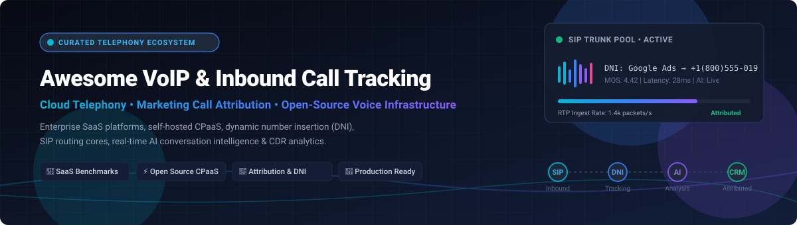

<p align="center">
  <a href="https://github.com/ishandutta2007/Awesome-Awesome-Awesome"></a>
  <a href="https://discord.gg/jc4xtF58Ve"></a>
  <a href="https://github.com/ishandutta2007/Awesome-Awesome-Awesome"></a>
  <a href="https://github.com/ishandutta2007"></a>
</p>

# 📞 Awesome VoIP & Inbound Call Tracking

<p align="center">
  
</p>

<p align="center">
  <strong>A curated directory of top Cloud Telephony SaaS, Dynamic Number Insertion (DNI), Inbound Call Tracking, and Open-Source Voice Infrastructure.</strong>
</p>

<p align="center">
  <a href="#-sector-overview--market-dynamics">Sector Overview</a> •
  <a href="#-saas--hosted-platforms">SaaS Platforms</a> •
  <a href="#-open-source-github-projects">Open-Source Projects</a> •
  <a href="#-key-concepts--telephony-architecture">Architecture</a> •
  <a href="#-support--sponsor">Support</a> •
  <a href="#-star-history">Star History</a> •
  <a href="#-how-to-contribute">Contributing</a>
</p>

---

## 🌐 Overview & SEO Keywords

Welcome to the definitive awesome list for **VoIP (Voice over IP)**, **Inbound Call Tracking**, **Call Attribution**, and **Programmable Telephony Infrastructure**. Whether you are building an AI-powered voice agent, optimizing marketing campaigns with Dynamic Number Insertion (DNI), or deploying carrier-grade SIP proxies and contact centers, this repository curates both enterprise SaaS solutions and self-hostable open-source frameworks.

> **Key Focus Areas**: Cloud PBX • Call Tracking Software • Dynamic Number Insertion (DNI) • Call Detail Records (CDR) • CPaaS (Communications Platform as a Service) • SIP Trunking • WebRTC • Conversational AI & Speech Analytics • IVR & Omnichannel Routing • Telephony Fraud Detection.

---

## 📊 Sector Overview & Market Dynamics

The global **VoIP and Cloud Telephony market** is estimated at **$160B–$175B in 2025–2026** (scaling toward $200B+ at a ~10–12% CAGR), driven by enterprise cloud migrations and AI voice agents, while the dedicated **Call Tracking & Attribution Software market** represents approximately **$3B–$5B**. The overall telephony landscape is **moderately fragmented**: enterprise UCaaS and core CRM ecosystems exhibit strong platform consolidation around category heavyweights, yet regional carriers, specialized DNI marketing attribution engines, and developer-first CPaaS platforms maintain vibrant fragmentation across mid-market and self-hosted environments.

---

## 📑 Table of Contents

- [📊 Sector Overview & Market Dynamics](#-sector-overview--market-dynamics)
- [🏢 SaaS / Hosted Platforms](#-saas--hosted-platforms)
- [💻 Open-Source GitHub Projects](#-open-source-github-projects)
  - [⭐ Open-Source Solutions by Community Stars](#-open-source-solutions-ranked-by-stars)
  - [Detailed Project Breakdown](#-detailed-open-source-breakdowns)
- [🏗️ Key Concepts & Telephony Architecture](#-key-concepts--telephony-architecture)
- [💖 Support & Sponsor](#-support--sponsor)
- [⭐ Star History](#-star-history)
- [🤝 How to Contribute](#-how-to-contribute)
- [⚖️ Disclaimer & Compliance](#-disclaimer--compliance)

---

## 🏢 SaaS / Hosted Platforms

Below is a structured breakdown of industry-leading commercial VoIP and call-tracking SaaS platforms, evaluated by **pricing transparency**, **trial terms**, and **company scale** (sorted by valuation / market cap descending):

| Company / Product | Starting Price (Billed Annually) | Free Tier / Trial Allowance | Company Scale (Valuation / Market Cap / Rev) | Key Capabilities & Highlights |
| :--- | :--- | :--- | :--- | :--- |
| **[HubSpot Inbound Calling](https://www.hubspot.com/)** 🚀 | **$15/user/month** (Sales/Service Hub Starter) | **Free Forever CRM tier** (0 inbound numbers; manual logging); Paid plans offer 14-day trials on request | **~$12B–$13B Market Cap** (~$2.6B Annual Rev) | Native CRM phone numbers, automated inbound call logging, synchronized contact timelines, and voicemail drop. |
| **[Talkdesk](https://www.talkdesk.com/)** 🎧 | **$85/user/month** (Digital / Voice Essentials) | **No self-serve free trial** (Sales demo and custom proof-of-concept credits upon qualification) | **~$10B Valuation** (~$315M Annual Rev) | AI-powered enterprise contact center (CCaaS), real-time transcription, agent assistance, and omnichannel routing. |
| **[RingCentral](https://www.ringcentral.com/)** 🌐 | **$20/user/month** (RingEX Core) | **14-day free trial** (Capped at 5 users, 2 desk phones; SMS disabled during trial) | **~$6.3B Market Cap** (~$2.51B Annual Rev) | Unified communications (UCaaS), enterprise cloud PBX, unlimited US/CA calling, team messaging, and video conferencing. |
| **[Vonage](https://www.vonage.com/)** 📱 | **$13.99/line/month** (Mobile Plan) | **No standard self-serve trial** (14-day demo / sales evaluation sandbox for unified comms) | **$6.2B Acquisition** by Ericsson (~$1.4B Annual Rev) | Cloud PBX, unified business communications, and enterprise-grade programmable voice/video APIs (Nexmo engine). |
| **[Nextiva](https://www.nextiva.com/)** 💼 | **$15/user/month** (Digital / Core Plan) | **30-day money-back guarantee** (No ongoing free tier; live guided interactive demo sandbox) | **~$2.7B Valuation** (~$250M Annual Rev) | Cloud business phone, IVR routing, team collaboration, CRM integrations, and omnichannel customer communication. |
| **[Dialpad](https://www.dialpad.com/)** 🤖 | **$15/user/month** (Dialpad Connect Standard) | **14-day free trial** (Full access to core VoIP and AI features for testing) | **~$2.2B Valuation** (~$300M ARR) | Real-time AI transcription, live sentiment analysis, call recording, voice summary notes, and CRM integration. |
| **[Aircall](https://aircall.io/)** ☎️ | **$30/user/month** (Essentials; 3-user minimum = $90/mo) | **7-day free trial** (Capped at 3 numbers, 100 call minutes total, max 7 mins/call, 100 SMS) | **~$1B Valuation** (~$200M ARR) | Cloud call center built specifically for sales and support; native integrations with HubSpot, Salesforce, and Zendesk. |
| **[CallRail](https://www.callrail.com/)** 🎯 | **$50/account/month** (Call Tracking Tier) | **14-day free trial** (Includes 5 local trackable numbers and 100 minutes of call/transcription usage) | **~$500M–$1B Valuation** (~$100M Annual Rev) | Market-leading dynamic number insertion (DNI), multi-touch PPC/SEO attribution, and conversation intelligence. |
| **[8x8](https://www.8x8.com/)** 📡 | **$15/user/month** (8x8 Express) | **30-day free trial** (Includes unlimited calling within US/Canada, business SMS, and basic video meetings) | **~$300M Market Cap** (~$710M Annual Rev) | Integrated cloud phone system, contact center capabilities, cross-region SIP routing, and global carrier interconnects. |
| **[CloudTalk](https://www.cloudtalk.io/)** ⚡ | **$19/user/month** (Starter Plan) | **14-day free trial** (No credit card required; includes test credit and international number provisioning) | **~$150M–$200M Valuation** (~$35M Annual Rev) | Modern cloud call center software, smart dialers, skill-based IVR, real-time call monitoring, and mid-market workflows. |

---

## 💻 Open-Source GitHub Projects

Open-source VoIP and call tracking repositories deliver remarkable flexibility at the infrastructure, softswitch, and non-invasive monitoring layers.

### ⭐ Open-Source Solutions Ranked by Stars

All projects below are ordered by community adoption (GitHub stargazers count descending), featuring social badges linked directly to their stargazer history:

| Project | GitHub Stars | Core Language / Stack | Primary Focus |
| :--- | :--- | :--- | :--- |
| **[LiveKit](https://github.com/livekit/livekit)** 🎥 | [](https://github.com/livekit/livekit/stargazers) | Go / WebRTC | Real-time WebRTC infrastructure, telephony SIP gateway & multimodal voice AI |
| **[Fonoster](https://github.com/fonoster/fonoster)** 📞 | [](https://github.com/fonoster/fonoster/stargazers) | Node.js / TypeScript | Open-source alternative to Twilio; programmable voice, SIP trunking & IVR flows |
| **[FreeSWITCH](https://github.com/signalwire/freeswitch)** 🎛️ | [](https://github.com/signalwire/freeswitch/stargazers) | C / C++ | High-capacity carrier softswitch, call routing, audio recording & CDR core |
| **[Asterisk](https://github.com/asterisk/asterisk)** 🏛️ | [](https://github.com/asterisk/asterisk/stargazers) | C | The foundational open-source PBX engine, IVR, dialplans, and media gateway |
| **[Kamailio](https://github.com/kamailio/kamailio)** 🌐 | [](https://github.com/kamailio/kamailio/stargazers) | C | Blazing-fast SIP proxy, registrar, load-balancer, and telecom routing engine |
| **[HOMER](https://github.com/sipcapture/homer)** 🔍 | [](https://github.com/sipcapture/homer/stargazers) | Go / C / Web | Packet capture and monitoring for SIP/VoIP/RTC, HEP capture, and diagnostics |
| **[OpenSIPS](https://github.com/OpenSIPS/opensips)** 🚦 | [](https://github.com/OpenSIPS/opensips/stargazers) | C | Multi-functional SIP server, high-throughput call proxy, and accounting generator |
| **[RTPEngine](https://github.com/sipwise/rtpengine)** 🔊 | [](https://github.com/sipwise/rtpengine/stargazers) | C | Kernel-level proxy for RTP/SRTP audio/video streams, transcoding, and recording |
| **[Linphone Desktop](https://github.com/BelledonneCommunications/linphone-desktop)** 🖥️ | [](https://github.com/BelledonneCommunications/linphone-desktop/stargazers) | C++ / QML | Cross-platform SIP client and softphone for desktop call handling and testing |
| **[Drachtio Server](https://github.com/drachtio/drachtio-server)** ⚡ | [](https://github.com/drachtio/drachtio-server/stargazers) | C++ | High-performance SIP signaling server with Node.js/Go control applications |
| **[Sippy B2BUA](https://github.com/sippy/b2bua)** 🔄 | [](https://github.com/sippy/b2bua/stargazers) | Python / C | Back-to-Back User Agent for call routing, CDR billing, and stateful tracking |
| **[Comcent Community Edition](https://github.com/comcent-io/comcent-ce)** 🤖 | [](https://github.com/comcent-io/comcent-ce/stargazers) | Go / Vue / Docker | Single-box turn-key contact center, WebRTC dialer, AI voice bots & transcription |
| **[VoIPbin](https://github.com/voipbin/monorepo)** 📦 | [](https://github.com/voipbin/monorepo/stargazers) | Go / Kubernetes | Modular self-hostable CPaaS monorepo: call flows, AI bots, DIDs & conferences |
| **[Jambonz API Server](https://github.com/jambonz/jambonz-api-server)** 🧩 | [](https://github.com/jambonz/jambonz-api-server/stargazers) | Node.js | Modern open-source CPaaS designed specifically for speech and conversational AI |
| **[CDR-Stats](https://github.com/Star2Billing/cdr-stats)** 📈 | [](https://github.com/Star2Billing/cdr-stats/stargazers) | Python / Django | Call detail record analysis, telecom fraud detection, and reporting suite |
| **[CXMind](https://github.com/Sonicwell/cxmind)** 🧠 | [](https://github.com/Sonicwell/cxmind/stargazers) | Go / React | Non-invasive VoIP analytics via HEP capture, PCI-DSS DTMF masking & AI coaching |
| **[Wazo Call-Logd](https://github.com/wazo-platform/wazo-call-logd)** 📝 | [](https://github.com/wazo-platform/wazo-call-logd/stargazers) | Python | REST API daemon for collecting, querying, and exporting CDRs in Wazo stacks |

---

### 🔍 Detailed Open-Source Breakdowns

#### 1. Full CPaaS, Real-Time WebRTC & Contact Center Frameworks
- **[LiveKit](https://github.com/livekit/livekit)**: An end-to-end WebRTC stack engineered for real-time voice, video, and data streams. Features a dedicated Telephony SIP Gateway allowing users to bridge PSTN/SIP trunks directly into WebRTC and generative voice AI agents.
- **[Fonoster](https://github.com/fonoster/fonoster)**: An open-source, programmable telecommunications stack inspired by Twilio. Connects carriers with cloud software, provides Node.js SDKs, manages numbers, runs IVRs, and deploys serverless voice apps.
- **[VoIPbin](https://github.com/voipbin/monorepo)**: A production-grade CPaaS backend deployed on Kubernetes. Features modular microservices including `bin-call-manager` (routing), `bin-flow-manager` (programmable workflows), and `bin-ai-manager` (LLM-driven IVR).
- **[Comcent CE](https://github.com/comcent-io/comcent-ce)**: A turnkey self-hosted contact center runnable on a single Linux server with Docker. Includes in-browser WebRTC agent dialers, SIP trunk linking, automatic call recording, AI transcription, and voice bots.
- **[Jambonz](https://github.com/jambonz/jambonz-api-server)**: The open-source voice platform created specifically for conversational AI applications. Integrates FreeSWITCH, Drachtio, and leading speech-to-text / text-to-speech engines.

#### 2. Carrier-Grade Telephony Engines & SIP Routing Cores
- **[FreeSWITCH](https://github.com/signalwire/freeswitch)**: High-capacity multi-protocol softswitch designed for real-time voice and video processing, audio transcoding, IVR scripting, and raw CDR generation.
- **[Asterisk](https://github.com/asterisk/asterisk)**: The grandfather of open-source PBX platforms. Provides the media and signaling foundation for hundreds of commercial telecom and inbound call routing vendors worldwide.
- **[Kamailio](https://github.com/kamailio/kamailio)**: High-concurrency SIP server capable of routing thousands of call setups per second, load-balancing traffic across media clusters, and securing SIP endpoints.
- **[OpenSIPS](https://github.com/OpenSIPS/opensips)**: High-performance SIP proxy and routing engine offering fine-grained traffic distribution, session timer enforcement, and custom CDR accounting.
- **[Drachtio Server](https://github.com/drachtio/drachtio-server)**: Modern SIP signaling platform enabling web developers to control call state and session routing using familiar languages like Node.js.
- **[Sippy B2BUA](https://github.com/sippy/b2bua)**: RFC-compliant SIP Back-to-Back User Agent providing stateful call control, rating, and CDR accounting between multiple carrier endpoints.
- **[RTPEngine](https://github.com/sipwise/rtpengine)**: In-kernel proxy for handling media traffic between NAT networks, transcoding audio codecs, and capturing raw PCAP voice streams.

#### 3. Analytics, Monitoring & CDR Auditing
- **[HOMER (SIPCapture)](https://github.com/sipcapture/homer)**: Enterprise-grade packet capture, storage, and visual troubleshooting environment for VoIP/SIP/WebRTC network flows using the HEP protocol.
- **[CXMind](https://github.com/Sonicwell/cxmind)**: Non-invasive VoIP analytics platform that passively captures HEP/SIP traffic to evaluate call quality (MOS), compliance, DTMF PCI masking, and agent coaching.
- **[CDR-Stats](https://github.com/Star2Billing/cdr-stats)**: Classic CDR auditing engine designed to ingest millions of call records from FreeSWITCH and Asterisk, identifying traffic anomalies and potential toll fraud.
- **[Wazo Call-Logd](https://github.com/wazo-platform/wazo-call-logd)**: Microservice daemon dedicated to recording, indexing, and serving call records and recordings via REST APIs.

---

## 🏗️ Key Concepts & Telephony Architecture

To understand how VoIP and Inbound Call Tracking function together, consider the end-to-end call lifecycle:

```
[ Caller ]
    │
    ▼
[ PSTN / Telco Carrier ]
    │ (SIP INVITE)
    ▼
[ SIP Proxy / SBC (Kamailio / OpenSIPS) ]
    │
    ├─► [ Non-Invasive Sniffer (CXMind / HOMER / HEP) ] ──► [ Call Quality & Analytics ]
    │
    ▼
[ Media Switch (FreeSWITCH / Asterisk / RTPEngine) ]
    │
    ├─► [ Dynamic Number Insertion (DNI) Engine ] ────► [ Match Web Session / Ad Campaign ]
    │
    ├─► [ Audio Stream / WebRTC Gateway (LiveKit) ] ──► [ Conversational AI & Speech-to-Text ]
    │
    ▼
[ CRM / Webhook Endpoint (HubSpot / Webhook) ] ────────► [ Attributed Deal / Ticket ]
```

1. **Dynamic Number Insertion (DNI)**: JavaScript on a web page displays a unique phone number from a pool based on the visitor's referrer, UTM tags, or session ID, linking the phone call to marketing attribution.
2. **SIP Signaling vs. RTP Media**: SIP (Session Initiation Protocol) negotiates call setup, routing, and termination, while RTP (Real-time Transport Protocol) carries the actual audio payload.
3. **CDR (Call Detail Record)**: Metadata produced at call termination containing timestamp, duration, caller ID, destination, disposition (answered/busy), and carrier cost.

---

## 💖 Support & Sponsor

Thank you for exploring and utilizing the **Awesome VoIP & Inbound Call Tracking** resource list! 🌟

If this repository saved you time, informed your architecture, or assisted in your marketing attribution stack, please consider supporting the project:

- ⭐ **Star this repository** to help others discover it across GitHub.
- 🍴 **Fork and share** with colleagues, developers, and telecom teams.
- ☕ **Buy a coffee or sponsor** on the [GitHub Sponsor Dashboard](https://github.com/sponsors/ishandutta2007) to help support continuous curation and open-source research.

[](https://github.com/sponsors/ishandutta2007)
[](https://www.buymeacoffee.com/ishandutta2007)

---

## ⭐ Star History

[](https://star-history.dera.page/#ishandutta2007/Awesome-VOIP-Inbound-Call-Tracking&type=date&legend=top-left)

---

## 🤝 How to Contribute

We welcome community contributions from telephony engineers, voice bot creators, and marketing analytics professionals!

1. 🍴 **Fork** this repository.
2. 🌿 **Create a Branch**: `git checkout -b feature/new-telephony-entry`
3. 📝 **Add Your Entry**: Ensure SaaS entries include verified pricing/trial limits, or open-source entries include valid GitHub links and tech stacks.
4. 📬 **Submit a PR**: Provide a brief overview explaining why the platform or tool deserves a spot on the list.

---

## ⚖️ Disclaimer & Compliance

- **Community Curated**: This list is independently maintained for educational and reference purposes; listings do not represent commercial endorsements.
- **Call Recording Consent**: Telecom operators and call tracking users must adhere to international privacy legislation (GDPR, CCPA) and applicable call recording consent laws (one-party vs. two-party notification requirements).
- **Payment Security**: When capturing customer payments over phone lines, organizations must ensure PCI-DSS compliance (e.g., automated DTMF masking or pausing recordings during card entry).
